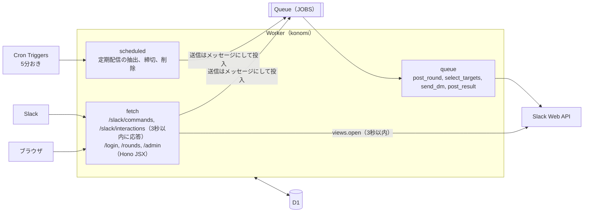

# konomi 基本設計

2026-11-20 作成。要件定義書：[requirements.md](requirements.md)

## この文書について

konomi MVP を実装するための基本設計。仕様の正は `docs/requirements.md`（2026-11-20版）で、この文書はそれを「どのモジュールで、どの順に、どう作るか」に落としたもの。

- 範囲：要件定義書の 3〜8 章（MVPの範囲）。次の版の機能（自由記述、リマインドなど）は扱わない
- 要件定義書と食い違う箇所があれば要件定義書が優先
- 要件にない判断は「仮」と書き、最後の「確認したいこと」に集めた。承認されたものから要件定義書に反映する
- 実装は要件定義書の「10. 実装ステップ」の順。各節に関係するステップ番号を [1]〜[8] で付ける

## 全体構成

1つの Worker が `fetch`（Slack と Web）、`scheduled`（Cron）、`queue`（Queue 受信）の3つの入口を持ち、Slack への送信は原則 `queue` から行う。

例外は `views.open` と、モーダルの応答本文だけ。これらは 3 秒以内に必要なため `fetch` の中で直接行う。

## モジュール構成

依存は「入口（slack / web / jobs）→ core → db」の一方向にする。core は Slack も Hono も知らず、外とのやり取りはインターフェース（ポート）経由で行う。

| ディレクトリ | 責務 | 依存してよいもの |
| --- | --- | --- |
| `src/index.ts` | Worker の入口。`fetch`（Honoアプリ）、`scheduled`（Cron）、`queue`（Queue受信）を返す | すべて |
| `src/core/` | お題選び、配信の作成、対象者の選定と除外、回答の可否判定、集計、締切、次回実行時刻の計算、管理者判定 | `src/db`、`core/ports.ts` の型だけ |
| `src/core/ports.ts` | core が外を呼ぶための型。`Messenger`（投稿・DM・スレッド投稿）、`Directory`（チャンネルのメンバー、ユーザーの種類）、`Clock` | なし |
| `src/slack/` | 署名検証、team_id照合、コマンド・ボタン・モーダル送信の受付、Block Kit の組み立て、Slack Web API クライアント（`Messenger`・`Directory` の実装） | `src/core`、`src/i18n` |
| `src/web/` | 結果ページ・管理画面（Hono JSX）、Sign in with Slack、セッション、CSRF、CSP | `src/core`、`src/i18n` |
| `src/jobs/` | Cron と Queue の処理。配信対象の抽出、メッセージの投入と受信、締切処理、削除処理 | `src/core`、`src/slack`（ポートの実装を渡すため） |
| `src/db/` | Drizzle のスキーマとリポジトリ（テーブルごとの読み書き関数）。`batch()` もここだけで使う | `drizzle-orm` |
| `src/i18n/` | 文言。`ja.ts` にキーと文字列を置き、`t(key, vars)` で引く。将来 `en.ts` を足す | なし |
| `src/config.ts` | `env` の読み込みと検証（`ADMIN_USER_IDS` の分割など）。不足があれば起動時にエラー | なし |
| `migrations/` | Wrangler で適用するSQL。`drizzle-kit generate` で作る | ― |
| `seed/` | 同梱するお題（日本語） | ― |
| `test/` | Vitest（`@cloudflare/vitest-plugin`） | ― |

- Discord 対応時は `src/discord/` を足し、同じポートを実装するだけで core を変えない
- DB 差し替え時は `src/db` のリポジトリだけを書き換える。core から SQL や Drizzle を直接書かない

## エンドポイント一覧

Slack 用は2本だけで、Events API は MVP では使わない。Web はサーバー側で描いた HTML とフォーム送信で完結させ、JavaScript は載せない（仮）。

| メソッドとパス | 用途 | 認可 | ステップ |
| --- | --- | --- | --- |
| `POST /slack/commands` | `/konomi`、`/konomi optout`、`/konomi optin` | Slack署名 ＋ team_id。`/konomi` は管理者のみ | [2][3] |
| `POST /slack/interactions` | 「回答する」ボタン、手動配信モーダルと回答モーダルの送信 | Slack署名 ＋ team_id | [2][3] |
| `GET /healthz` | 死活確認。DBに触れない | なし | [1] |
| `GET /login` | Slack の認可画面へリダイレクト（state・nonce を発行） | なし | [6] |
| `GET /auth/slack/callback` | code を id_token に交換して検証、セッション作成 | state と nonce | [6] |
| `POST /logout` | セッション削除 | ログイン ＋ CSRF | [6] |
| `GET /` | `/rounds` へリダイレクト | ログイン | [6] |
| `GET /rounds` | 過去の配信の一覧（新しい順、ページ分割） | ログイン | [6] |
| `GET /rounds/:id` | 1配信の結果（票数と割合。記名の配信は選択肢ごとの回答者名も） | ログイン | [6] |
| `GET /admin` | 管理画面トップ | 管理者 | [7] |
| `GET・POST /admin/settings` | 対象チャンネル、タイムゾーン、除外条件、無期限の上限、保存期間 | 管理者 ＋ CSRF | [7] |
| `GET・POST /admin/topics`、`/admin/topics/:id` | お題の追加・編集・無効化 | 管理者 ＋ CSRF | [7] |
| `GET・POST /admin/schedules`、`/admin/schedules/:id` | 配信スケジュールの追加・編集・停止 | 管理者 ＋ CSRF | [7] |
| `GET /admin/rounds`、`POST /admin/rounds/:id/close` | 配信の一覧と手動終了 | 管理者 ＋ CSRF | [4][7] |
| `GET /admin/rounds/:id/answers` | 記名での回答の確認 | 管理者 | [7] |
| `GET・POST /admin/admins` | 管理者の追加・削除（`ADMIN_USER_IDS` の人は削除不可と表示） | 管理者 ＋ CSRF | [7] |
| `GET・POST /admin/users` | 管理者が指定する除外、オプトアウト状態の確認 | 管理者 ＋ CSRF | [7] |

- 「ログイン」は有効なセッションがあること。なければ `/login?next=<元のパス>` へ（`next` は同じオリジンのパスだけ許す）
- 「管理者」はリクエストごとに `ADMIN_USER_IDS` と `admins` を見て判定する。セッションに管理者フラグを持たせない
- 結果ページのリンクは `APP_BASE_URL` を元に作る（例：`<APP_BASE_URL>/rounds/42`）

## 主要な処理フロー

どのフローも「Slackには3秒以内に返し、送信は Queue に回す」形にする。配信や締切の状態は「条件付き UPDATE が1行更新できたときだけ先へ進む」で二重実行を防ぐ。

### 手動配信（`/konomi`）[3]

1. 署名と team_id を検証し、管理者か確認する（違えば本人だけに見える応答）
2. 有効なお題を読み、`views.open` で配信モーダル（お題・配信タイプ・締切）を開いてから 200 を返す
3. モーダル送信で入力を検証し、無期限なら上限を確認する（超えたらモーダルにエラー表示）
4. `rounds` に受付中で作成し、`topics.last_used_at` を更新（`batch()`）してモーダルを閉じる
5. チャンネル型は `post_round` 、DM型は `select_targets` を Queue に入れる

### 回答 [3]

1. 「回答する」が押されたら、配信・選択肢・自分の回答を `batch()` でまとめて読む
2. 受付中で回答できる人なら `views.open` で回答モーダルを開く。前回の回答を初期選択し、「管理者は記名で回答を確認できます」と表示する。記名の配信では「この回答は名前付きで結果ページに表示されます」と表示する
3. 対象外・締切後は、モーダルを開かず本人だけに見えるメッセージを返す
4. 送信時にもう一度、team_id・締切前か・回答できる人かを確認する
5. `answers` に `ON CONFLICT (round_id, user_id) DO UPDATE` で保存し、モーダルを「回答ありがとうございます」＋結果ページのリンクに差し替える

回答できる人：チャンネル型は「除外対象でない」こと、DM型は `round_targets` にいること。チャンネルのメンバーかどうかの確認方法は「確認したいこと」を参照。

### 定期配信（Cron 5分おき → Queue）[5]

1. `schedules` から `is_active = 1 AND next_run_at <= now` を取る（1回最大10件、仮）
2. 各スケジュールで、次回時刻を計算し `UPDATE … SET next_run_at = 次回 WHERE id = ? AND next_run_at = 今回` を実行。更新できたものだけ配信する
3. 祝日なら配信せず次回へ進める
4. 配信タイプに合う未使用のお題からランダムに選ぶ（未使用がなければ `last_used_at` が古いものから）
5. 配信を作り、手動配信と同じく Queue に渡す

### Queue のメッセージ [3][4][5]

| 種類 | 中身 | 処理 | 二重実行の防ぎ方 |
| --- | --- | --- | --- |
| `post_round` | round_id | チャンネルにお題と「回答する」「結果を見る」を投稿し、`rounds.message_ts` を保存 | `message_ts` が空のときだけ投稿 |
| `select_targets` | round_id | チャンネルのメンバーとユーザー一覧を取り、除外を適用して N 人選び、`round_targets` に入れて `send_dm` を人数分入れる | `round_targets` が空のときだけ選ぶ |
| `send_dm` | round_id, user_id | DMを開いて依頼を送り、`round_targets.message_ts` を保存 | `message_ts` が空のときだけ送る |
| `post_result` | round_id | 集計して元の投稿のスレッドに概要とリンクを1件投稿 | 終了への条件付き UPDATE が成功したときだけ投入 |

- 429 は `Retry-After` 秒を `msg.retry({ delaySeconds })` に渡して再送する。その他の一時エラーは Queue の再試行に任せ、最大回数を超えたら捨ててログだけ残す
- DM型のスレッド投稿は「各人のDMに1件ずつ」とする（仮）

### 締切と手動終了 [4]

1. Cron ごとに `status = 'open' AND deadline_at <= now` を取る
2. `UPDATE rounds SET status = 'closed' WHERE id = ? AND status = 'open'` が成功したものだけ `post_result` を投入
3. 管理画面の手動終了も同じ UPDATE と投入を使う

### ログイン（Sign in with Slack）[6]

1. `/login` で state と nonce を作り `login_states` に保存（有効10分、仮）し、`team=SLACK_TEAM_ID` を付けて Slack の認可画面へ
2. コールバックで state を削除しながら照合（1回だけ使える）し、`openid.connect.token` で id_token を受け取る
3. id_token の `iss`、`aud`、`exp`、`nonce`、`https://slack.com/team_id` を検証する
4. セッションを作り Cookie を設定して `next` へ戻す

### 定期的な削除 [8]

- Cron の中で1日1回（仮）、期限切れの `sessions`・`login_states` と、保存期間を過ぎた配信の回答を削除する。1回の削除は件数を区切る

## データ設計の詳細

要件定義書の「5. データ設計」のテーブルと列をそのまま使い、型・初期値・外部キーを決めた。日時はすべてUNIX時間の**秒**（INTEGER）、真偽値は INTEGER の 0/1。ステップ[1]で最初のマイグレーションとして全部作る。

### 値の表現

| 列 | 表現 | 例 |
| --- | --- | --- |
| `recommended_type` | `'channel'` ｜ `'dm'` ｜ `'any'` | `'any'` |
| `schedules.type`、`rounds.type` | `'channel'` ｜ `'dm'` | `'channel'` |
| `rounds.status` | `'open'`（受付中）｜ `'closed'`（終了） | `'open'` |
| `days_of_week` | 曜日のビット（日=1, 月=2, … 土=64） | 平日 = 62 |
| `time` | `'HH:MM'`（`settings.timezone` の現地時刻） | `'10:00'` |
| `deadline_rule` | JSON文字列。`{"kind":"at","time":"18:00"}` ｜ `{"kind":"after","hours":8}` ｜ `{"kind":"none"}` | `{"kind":"at","time":"18:00"}` |
| `timezone` | IANA の名前 | `'Asia/Tokyo'` |
| `sessions.id` | ランダムなセッションIDの SHA-256（Cookie の値そのものは保存しない） | 64桁の16進 |

### テーブル

| テーブル | 列と型（初期値） | キー・外部キー・インデックス |
| --- | --- | --- |
| settings | id INT=1, channel_id TEXT NULL, timezone TEXT ('Asia/Tokyo'、仮), exclude_recent_days INT (7), include_guests INT (0), max_open_unlimited INT (10), retention_days INT (365) | PK id、CHECK id = 1。最初のマイグレーションで1行入れる |
| admins | user_id TEXT, added_by TEXT, added_at INT | PK user_id |
| user_preferences | user_id TEXT, opted_out INT (0), excluded_by_admin INT (0) | PK user_id |
| topics | id TEXT（UUID）, question TEXT, recommended_type TEXT ('any'), answer_format TEXT ('choice'), result_visibility TEXT ('anonymous'), is_active INT (1), last_used_at INT NULL | PK id、IDX is_active |
| topic_choices | id INT, topic_id TEXT, label TEXT, position INT | PK id、FK topic_id → topics、IDX topic_id |
| schedules | id INT, type TEXT ('channel'), days_of_week INT (62), time TEXT ('10:00'), skip_holidays INT (1), deadline_rule TEXT, dm_count INT (3), is_active INT (1), next_run_at INT NULL | PK id、IDX (is_active, next_run_at) |
| rounds | id INT, topic_id TEXT, schedule_id INT NULL, type TEXT, result_visibility TEXT, channel_id TEXT, message_ts TEXT NULL, deadline_at INT NULL, status TEXT ('open'), created_at INT | PK id、FK topic_id → topics、FK schedule_id → schedules（削除時 NULL）、IDX status、IDX (status, deadline_at) |
| round_targets | round_id INT, user_id TEXT, dm_channel_id TEXT NULL, message_ts TEXT NULL | PK (round_id, user_id)、FK round_id → rounds（連動削除） |
| answers | round_id INT, user_id TEXT, choice_id INT, answered_at INT, updated_at INT | UNIQUE (round_id, user_id)、FK round_id → rounds（連動削除）、FK choice_id → topic_choices |
| sessions | id TEXT, user_id TEXT, expires_at INT | PK id、IDX expires_at |
| login_states | state TEXT, nonce TEXT, expires_at INT | PK state |

- お題と選択肢は、配信後に編集されると過去の結果が変わる。そのため「配信済みのお題の選択肢は編集できず、無効化して新しく作る」とする（決定）
- 保存期間の削除は `rounds.created_at` が期間を過ぎた配信の `answers` を消す。配信も一緒に削除し、結果ページからも消える（決定）
- D1 は外部キー制約を有効にして動くため、削除の順番に注意する（子→親）

* `result_visibility` は `'anonymous'`（匿名）｜ `'named'`（記名）。配信を作るときにお題の値を `rounds` にコピーし、あとでお題を変えても過去の配信の表示は変わらない
* `answer_format` は `'choice'` ｜ `'text'` ｜ `'choice_other'`。MVPは `'choice'` だけを使い、自由記述と「その他の記入」は次の版で使う
* 記名表示の名前は DB に保存せず、結果ページを表示するたびに Slack の `users.list` から取る

## 設定値と環境

Wrangler の設定は `wrangler.jsonc` 1つで、最上位を手元（`wrangler dev` とテスト）用、`env.dev` と `env.production` をデプロイ先にする。Secrets と変数は要件定義書の7つから増やさない。

| 項目 | 手元（最上位） | `env.dev` | `env.production` |
| --- | --- | --- | --- |
| Worker 名 | `konomi-local`（仮。誤って本番名でデプロイしないため） | `konomi-dev` | `konomi` |
| D1（バインディング `DB`） | ローカルのD1 | `konomi-dev-db` | `konomi-db` |
| Queue（バインディング `JOBS`）[5] | ローカル | `konomi-dev-jobs`（仮） | `konomi-jobs`（仮） |
| Cron [5] | なし（手動で呼ぶ） | `*/5 * * * *` | `*/5 * * * *` |
| 変数 `SLACK_TEAM_ID`、`ADMIN_USER_IDS`、`APP_BASE_URL` | `.dev.vars` | `vars` | `vars` |
| Secrets | `.dev.vars` | `wrangler secret put --env dev` | `wrangler secret put --env production` |

- D1 は `database_name` だけを書き、`database_id` は書かない。初回のデプロイで Wrangler が同じ名前の D1 を自動で作る（手順は README）
- Cron と Queue の設定は使うステップ[5]で足す。ステップ[1]では D1 と変数だけ
- `src/config.ts` は起動時に必須値を確認し、不足していれば名前だけをログに出して 500 を返す（値は出さない）
- `.dev.vars` は `.gitignore` に入れ、`.dev.vars.example` だけをコミットする
- `manifest.yml` の URL は `https://<導入者のWorker>/slack/commands` などを置き換えて使う [2]

## セキュリティ設計

検証はすべて Web Crypto（`crypto.subtle`）で行い、暗号まわりのライブラリは入れない。比較は定数時間で行う。

| 対象 | 設計 | ステップ |
| --- | --- | --- |
| Slack の署名 | `v0:{timestamp}:{生の本文}` を `SLACK_SIGNING_SECRET` で HMAC-SHA256 し、`X-Slack-Signature` と比較。時刻のずれが5分を超えたら拒否。Hono のミドルウェアとして `/slack/*` に掛ける | [2] |
| team_id の照合 | コマンドは `team_id`、操作は `team.id` と `user.team_id` を `SLACK_TEAM_ID` と比べる。外部ユーザー（Slack Connect）は `user.team_id` が違うためここで弾かれる | [2] |
| ログイン | state と nonce は32バイトの乱数。state は1回限り。id_token はトークン窓口から TLS で直接受け取るため、クレーム（iss = `https://slack.com`、aud = `SLACK_CLIENT_ID`、exp、nonce、team_id）を検証する。署名（JWKS）検証はしない（仮） | [6] |
| セッション | Cookie `konomi_session` = `<セッションID>.<SESSION_SECRET による HMAC>`。DB には ID の SHA-256 だけ。`HttpOnly; Secure; SameSite=Lax; Path=/`、有効30日。ログアウトで削除 | [6] |
| CSRF | 更新系はすべて POST。フォームに `HMAC(SESSION_SECRET, セッションID)` のトークンを埋め、さらに `Origin` が `APP_BASE_URL` と一致するか確認 | [6][7] |
| 管理者の権限 | 管理画面の全ルートと `/konomi` で、毎回 `ADMIN_USER_IDS` と `admins` を参照。記名の回答を返すのは `/admin/rounds/:id/answers` だけ | [3][7] |
| CSP とヘッダー | 全画面で `default-src 'none'; style-src 'self' 'unsafe-inline'; img-src 'self'; form-action 'self'; frame-ancestors 'none'; base-uri 'none'`。加えて `X-Content-Type-Options: nosniff`、`Referrer-Policy: same-origin`。外部スクリプトは載せない | [6] |
| ログ | 出してよいのは種類・件数・所要時間・エラーコードと配信ID。トークン、署名、Cookie、回答内容、user_id、メッセージ本文は出さない。ログは `src/log.ts` 経由だけで出す | 全体 |
| 入力の検証 | Slack のペイロード、フォーム、クエリは型を確かめてから使う。検証は自前の小さな関数で行う（仮。依存を増やさないため） | 全体 |

## 制限への対応

各処理の外部リクエストと D1 クエリを、数百人規模でも 50 件未満に収める。見積もりは「メンバー500人」で計算した（仮）。

| 処理 | 外部リクエスト | D1 クエリ | 工夫 |
| --- | --- | --- | --- |
| 「回答する」ボタン | 1（`views.open`） | 1回の `batch()` | 必要なものをまとめて読んでからすぐ開く |
| 回答の送信 | 0〜1（ゲスト判定の `users.info`） | 2〜3 | モーダルの差し替えは応答本文で返す（API不要） |
| `/konomi` | 1（`views.open`） | 1〜2 | お題の選択肢は最大100件（Block Kit の上限） |
| Cron 1回 | 0 | 10〜30 | 抽出と状態更新だけ。送信はすべて Queue |
| `select_targets` | 約4（`conversations.members` 1 ＋ `users.list` 1〜3） | 3〜5 | `round_targets` は `batch()` で1回で入れる |
| `send_dm` × バッチ10件 | 20（`conversations.open` ＋ `chat.postMessage`） | 10〜20 | Queue の `max_batch_size` を 10 にする（仮） |
| `post_result` | 1（チャンネル型） | 2〜3 | DM型は対象者ごとに Queue で分ける |

- 3秒以内：Slack への応答を待たせる処理は `views.open` と少数の D1 読み取りだけ。それ以外は `executionCtx.waitUntil` か Queue
- Slack の再送：`X-Slack-Retry-Num` が付いたリクエストは、状態を見て二重に処理しない作り（回答は上書きなので安全、配信作成は `view.id` で重複を弾く（仮））
- 429：`Retry-After` 秒だけ待って再送。Queue ではその秒数で `retry` する
- CPU 10ミリ秒：依存は hono と drizzle-orm の2つだけ。Slack 連携は `slack-edge` を使わず自前で実装する（仮）

* 記名の結果ページ：名前の取得に `users.list` を1〜3回使う。D1 のクエリと合わせても 50 件未満に収まる

## 開発・テスト・CI

実行時の依存は hono と drizzle-orm の2つ。開発用の依存は Worker に含まれないため CPU 時間には影響しない。

| 用途 | 選定 | 理由 |
| --- | --- | --- |
| Lint・整形 | Biome（仮） | 1つで Lint と整形ができ、設定と依存が少ない。ESLint でもよい |
| 型チェック | `tsc --noEmit`（strict）＋ `wrangler types` で `Env` を生成 | 設定と型のずれを防ぐ |
| テスト | Vitest ＋ `@cloudflare/vitest-plugin` | Workers と同じランタイムで、ローカルのD1にマイグレーションを当てて動かせる |
| マイグレーション | `drizzle-kit generate` でSQLを作り、`wrangler d1 migrations apply` で適用 | 要件定義書の「マイグレーションはWranglerで適用」に合わせる |
| CI | GitHub Actions で `pnpm install --frozen-lockfile` → lint → typecheck → test | ステップ[1]の完了条件。追加には承認が必要 |

### テストの方針

- `src/core` はポートを偽物に差し替えて単体テスト。時刻は `Clock` で固定する
- `src/db` はローカルのD1で実際のSQLを流す（ユニーク制約、条件付き UPDATE、外部キー）
- `src/slack` は署名付きのリクエストを作って `SELF.fetch` で叩く。Slack Web API は `fetchMock` で差し替える
- 実際の Slack と Cloudflare での確認は、各PRに手元での確認手順として書く

## 確認したいこと

要件定義書に書かれていないため「仮」とした点。上ほど仕様への影響が大きい。それぞれ仮の案でよければチェックを入れ、変える場合はコメントください。決まったものから要件定義書に反映する。

### 決まったこと（2026-11-20）

- お題のバリエーションや季節版をまとめる仕組み（グループ）は作らない。お題ごとのIDで区別する
- 結果の表示方法（匿名／記名）をお題ごとに選べるようにし、MVPに入れる。要件定義書に反映済み
- 自由記述と「選択肢＋その他の記入」は次の版。お題に回答の形式の列だけ先に用意する
- モーダルで「その他の記入」を作るときは、記入欄を常に表示し、送信時に確認する（次の版）

* お題のIDはUUID。回答は独自のIDを持たず `(round_id, user_id)` で1件。配信などその他は連番
* 保存期間は初期値365日（日単位で変更可）。過ぎた配信は回答とともに配信ごと削除する

### 仕様に関わるもの

- [ ] **保存期間を過ぎた配信の扱い**：決定済み。初期値365日を過ぎた配信は、回答とともに配信ごと削除する
- [ ] **チャンネル型でメンバーかどうかの確認**：決定済み。APIでのメンバー確認はしない。team_id、オプトアウト、管理者の除外、ゲストだけ確認する
- [ ] **定期配信で無期限の上限を超えるとき**：決定済み。その回は配信せず次回へ進め、ログに残す。手動配信ではモーダルにエラーを出す
- [ ] **DM型の結果の通知先**：決定済み。各人のDMのスレッドに1件ずつ。DMの依頼にも「回答状況」として結果ページへのリンクを付ける
- [ ] **配信済みのお題の編集**：決定済み。質問文の修正は可、選択肢の編集は不可（無効化して作り直す）
- [ ] **タイムゾーンの初期値**：決定済み。`Asia/Tokyo`

### 実装の進め方に関わるもの

- [ ] **Slack 連携を自前で実装**（`slack-edge` を使わない）：使うAPIが数個で、署名検証も Web Crypto で数十行のため
- [ ] **id_token の署名検証を省く**：トークン窓口から TLS で直接受け取るため（OpenID Connect Core 3.1.3.7 で許されている）。要件定義書の検証項目（発行元・宛先・nonce）はすべて行う
- [ ] **Lint は Biome**：ESLint がよければ切り替える
- [ ] **日時は秒単位のUNIX時間**
- [ ] **画面に JavaScript を載せない**：フォーム送信だけで管理画面を作る。必要になったら同じWorkerから配信する
- [ ] **名前の仮置き**：手元のWorker名 `konomi-local`、Queue名 `konomi-dev-jobs`／`konomi-jobs`、Cookie名 `konomi_session`

要件定義書の「11. 未決事項」（コマンド名、祝日データ、配信時刻の初期値など）はこの設計では決めず、該当するステップの前に確認する。
